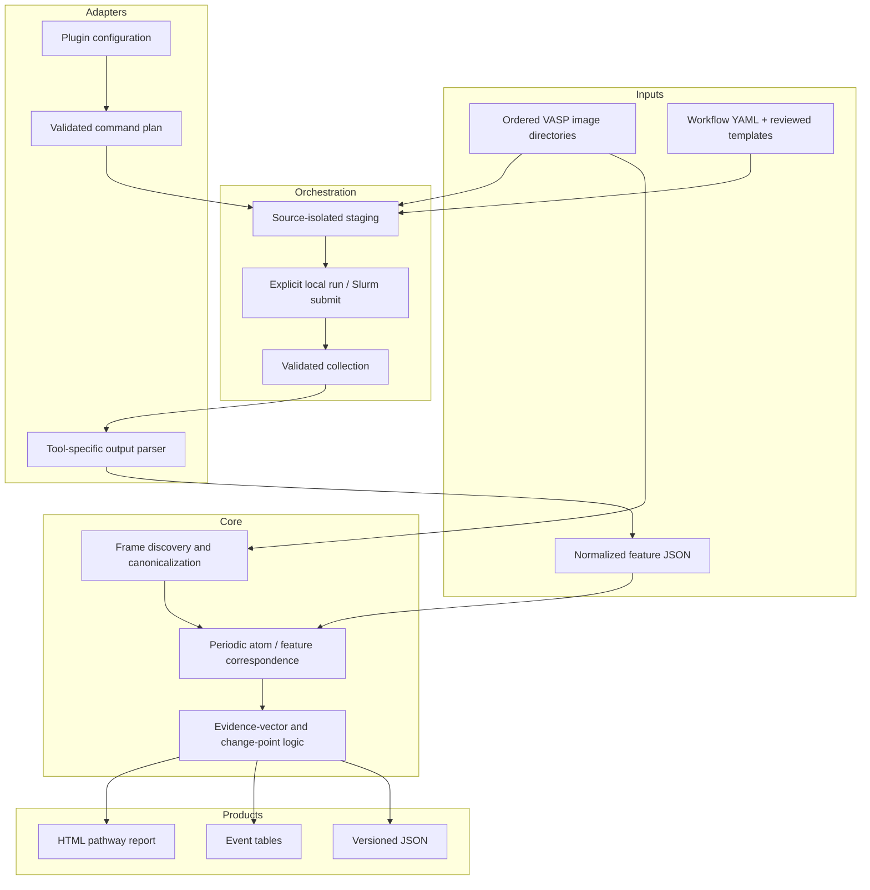

# Architecture

ElecTrace separates scientific correspondence logic from external analysis tools.
That boundary keeps provenance explicit, makes the core testable without licensed
software, and avoids silently treating one electronic descriptor as truth.

## Data flow

The plugin layer describes a subprocess as an argument vector, working directory,
standard input, required inputs, and expected outputs. Constructing that plan does
not execute it. ElecTrace implements a separate orchestration boundary that stages
jobs without execution, requires `--yes` for a local launch or Slurm submission, and
collects supported outputs into an isolated analysis tree. This boundary makes a
command auditable; it does not prove convergence or scientific validity.

## Layers

### 1. Discovery and canonical frames

Path discovery must be deterministic. Each frame receives an integer index, a stable
label, a cell, periodic boundary flags, an ordered atom table, and hashes of the
selected source files. Numeric image directory names are sorted numerically rather
than lexicographically.

Atom identity is never inferred from display labels alone. The 0.1 baseline expects a
consistent atom list and uses periodic geometry to validate or recover
correspondence. Ambiguity is surfaced rather than silently resolved.

### 2. Plugin boundary

Built-in adapters target BaderKit, critic2, LOBSTER, and Chargemol. They translate
project configuration into inspectable command plans and translate tool-specific
outputs into the [`electrace.features.v1`](spec/plugin-protocol-v1.md) envelope.
The CLI can produce one plan or a deterministic path-wide batch, but planning never
executes a tool. critic2 integration requests `critic2.features.json` through
`CPREPORT`; raw `.cro` output is not parsed as normalized evidence.

Adapters do not redefine the scientific meaning of external tools, redistribute
them, or bypass their licenses. Raw tool outputs remain important provenance and
should be retained alongside normalized records.

### 3. Explicit workflow orchestration

A versioned YAML manifest selects canonical frame indices, executable argument
vectors, reviewed template directories, scheduler policy, and an ordered dependency
DAG. Staging copies the selected structure and templates into a workspace outside
the source path. The source calculation directories remain read-only.

The workspace carries an ElecTrace marker and a hash of the source manifest.
Replacement is permitted only for a correctly marked, non-symlinked workspace; a
manifest change requires restaging. Local commands use argument arrays with
`shell=False`, dedicated working directories, separate output/error logs, required
input checks, and dependency failure propagation. Slurm preparation emits one
dependency-ordered script per selected frame. Preparing a script is non-executing;
submission is a second, explicit action.

Step `resources` values are advisory metadata in workflow v1. Local concurrency is
controlled by `--max-parallel`, while actual Slurm allocation comes from validated
`scheduler.directives`.

Collection is a separate success boundary. It requires nonempty, regular,
non-symlinked expected descriptor outputs, parses them against the associated frame,
and atomically copies supported evidence and selected structures under
`workspace/analysis`. Neither a zero exit status nor the existence of an expected
filename establishes DFT convergence, projection quality, or a valid scientific
interpretation. See the [external workflow guide](workflows.md) for the operational
contract.

### 4. Normalized feature model

Every frame contains zero or more frame-local electronic features. A feature has a
stable local identifier, a normalized `kind`, a fractional position, optional charge
and volume, zero-based neighboring atom indices, optional voxel support, and
extensible typed attributes.

Frame-local plugin identifiers are not cross-frame identities. The core engine owns
correspondence and persistent track identifiers so a parser cannot accidentally
assert temporal continuity.

### 5. Correspondence and evidence

ElecTrace 0.1 implements periodic atom matching and an experimental feature matcher
that combines deformation-aware displacement, periodic voxel overlap, charge,
volume, and neighboring-atom fingerprints. Hyperedges represent candidate splits,
merges, and rearrangements only when at least one complete, semantically compatible
charge or volume channel is conserved across every participant. Every complete
channel must pass the configured tolerance; a passing channel cannot average away a
failure in another. Proximity-only and partial-evidence groupings remain one-to-one
matches plus births/deaths, with structured rejection diagnostics in the transition
record.

Assignment ambiguity is evaluated against complete alternative assignments, not a
local pair-cost tie alone. A selected atom or feature decision is ambiguous when
forbidding it yields another complete assignment within the configured
`matching.ambiguity_tolerance` total-cost gap. Locally tied pairs that are resolved by
the rest of the assignment are not flagged. Likewise, equivalent one-to-one backbone
choices are treated as resolved when a conservation-backed hyperedge contains every
affected participant; the resolved alternatives remain in that edge's evidence.

That is an algorithmic implementation, not a validated general solution. Scientific
lineage claims still require benchmark data, grid-refinement studies, ambiguity
audits, and domain calibration. No 0.1 result should imply that basin identity or the
general split/merge problem is uniquely resolved.

### 6. Events and products

Event records should preserve an evidence vector: which descriptors changed, in
which direction, by how much, under what thresholds, with what convergence checks,
and with which warnings. Human-readable labels are views over that record.

Machine-readable JSON is the source product. CSV tables and HTML reports are derived
views and must retain links to the source frame, normalized record, configuration,
and software versions.

CSV is a spreadsheet-safe derived view, not the lossless interchange format. Any
string cell or untrusted column name whose first non-whitespace character is `=`,
`+`, `-`, or `@` is prefixed with an apostrophe to prevent formula execution in
spreadsheet software. Ordinary strings are unchanged, structured cells use strict
JSON, and the canonical analysis JSON retains the original values.

## Determinism and failure policy

- Stable sorting and stable tie-breaking are required.
- Non-finite JSON numbers are forbidden.
- Unknown schema major versions are rejected.
- Missing optional evidence is represented as missing, never as zero.
- A partial plugin result is visibly partial and cannot silently become a complete
  event vector.
- In strict mode, inconsistent atom counts/order, malformed cells, hash mismatches,
  and complete alternative mappings within the configured ambiguity tolerance fail
  the run before output publication.
- In permissive mode, the same conditions remain in transition diagnostics and
  warnings. Ambiguous atom mappings are excluded from neighbor evidence; ambiguous
  feature edges, births/deaths, lineage propagation, and property/topology events are
  suppressed.

## Trust boundaries

Input directories, templates, staged records, collected outputs, and external
executables are untrusted. Paths must be normalized; command plans use argument
arrays rather than shell strings; adapters must not embed credentials; selected
outputs must not escape through symlinks; HTML output must escape source-provided
text; and no input calculation is modified in place. Licensed pseudopotentials are
user-supplied and are never shipped by ElecTrace. See the
[security policy](https://github.com/Austin243/ElecTrace/blob/main/SECURITY.md) for
reporting concerns.
